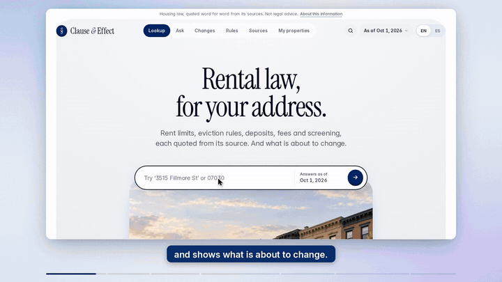
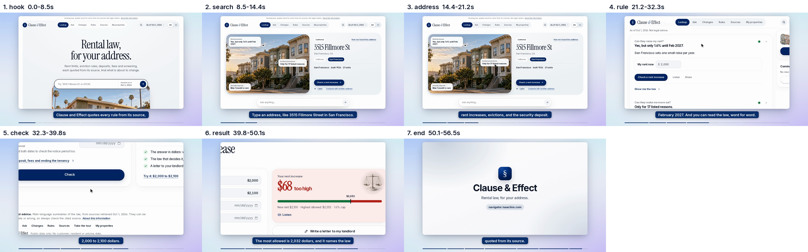

# demo-video: a Claude Code skill that turns a website into a product demo video

Give Claude Code a URL. It explores the site, finds the one flow worth showing, writes a short script from what the
site really says and shows, records the live site in a real browser and renders a polished demo video:

- 60 seconds or less, 1920x1080, H.264 + AAC mp4 (fits LinkedIn, X, YouTube, Product Hunt, pitch decks)
- Screen Studio style: rounded window on a soft gradient in your brand colour, eased zoom and pan on clicks, typing
  and highlights, a big smoothed cursor, click ripples, captions and a progress rail
- voice-over by ElevenLabs (optional), a soft click and typing sound, a quiet generated music bed that ducks under
  the voice, loudness at -16 LUFS
- checks every render: length, codecs, loudness, caption/voice sync, voice not cut at scene changes, contact sheets



Examples, each made end to end by a fresh Claude Code session from the one-line prompt below:

| Site | Video | Script | Length | Voice |
|---|---|---|---|---|
| [navigator.isaaclins.com](https://navigator.isaaclins.com) (rental law lookup) | [demo.mp4](examples/navigator/demo.mp4) | [scenes.json](examples/navigator/scenes.json) | 56.5 s | ElevenLabs, 624 characters |
| [demo.playwright.dev/todomvc](https://demo.playwright.dev/todomvc/) (to-do app) | [demo.mp4](examples/todomvc/demo.mp4) | [scenes.json](examples/todomvc/scenes.json) | 34.9 s | ElevenLabs, 421 characters |



## Install (3 steps)

1. Install the tools once (macOS: `brew install node ffmpeg uv`; Linux: your package manager for node and ffmpeg,
   and `curl -LsSf https://astral.sh/uv/install.sh | sh`).
2. Get the skill:
   ```bash
   git clone https://github.com/isaaclins/demo-video-skill ~/.claude/skills/demo-video
   ```
   (or copy the folder to `.claude/skills/demo-video` inside one project). The first run installs the Playwright
   package by itself; if it says Chromium is missing, run
   `cd ~/.claude/skills/demo-video && npx playwright install chromium`.
3. Optional, for a voice-over: `export ELEVENLABS_API_KEY=...` (an ElevenLabs key with text-to-speech permission)
   in the shell you start Claude Code from. Without it you get the same video with captions and music, no voice.

## Use it

Start Claude Code in any folder and say:

> Make a demo video of https://your-site.com

Claude explores the site, asks only what it cannot work out (for example demo-account login details, or which flow
to show if there are several), then drafts, builds, checks and fixes. You get `demo-video/<site>/out/demo.mp4`, plus
`demo_scenes.png` (one frame per scene) to review. Ask for changes in plain words ("shorter", "show pricing too",
"less zoom") and it rebuilds.

You can also drive it by hand: `~/.claude/skills/demo-video/dv build path/to/scenes.json` (see `SKILL.md` for the
scenes.json format and every command).

## Costs and time

- ElevenLabs: about 400-900 characters per video (the examples: 624 and 421; the free plan has 10,000 a month).
  Every take is cached by a hash of its text, so a rebuild only pays for lines you changed. The build prints the
  characters it used and stops at 4,000 characters per project unless you raise it (`--tts-budget`).
- Claude Code: one normal session (the example runs took 18-38 turns).
- Time: prompt to finished video took 7-14 minutes per example on a small 8-core Linux box (exploring and
  scripting a few minutes, a silent draft 1-2 minutes, the final render 3-5 minutes for 35-57 seconds of video).
- Disk: about 50-150 MB of work files per project (`build/` can be deleted afterwards).

## Requirements

Node 18+ (Playwright), ffmpeg + ffprobe, [uv](https://docs.astral.sh/uv/) (installs Python 3.10+ and numpy, scipy,
pillow on first run), about 2 GB of RAM. Optional: `ELEVENLABS_API_KEY`; `faster-whisper` for a speech-to-text check
(`dv build ... --stt` installs it); macOS `say` or `piper` as a local fallback voice (`--local-tts`, lower quality).

## Limits

- It records whatever the browser shows. Use a demo account and demo data, never real customer data.
- Public pages work best. Logins only with credentials you give it (they will be typed on screen). No CAPTCHA, 2FA
  or payments. Sites that block headless browsers will not work.
- Desktop layout (1280x720 viewport) only; no mobile video yet.
- JavaScript-driven animations play faster than CSS animations during capture; heavy WebGL or video backgrounds may
  stutter.
- Respect the sites you record: it checks robots.txt and visits like a normal user; only record sites you own or may
  show.

## Licence

MIT (see `LICENSE`). Bundled font: Inter, SIL Open Font License 1.1 (`assets/fonts/OFL.txt`). All sounds and music
are generated by the code; no samples are included.
